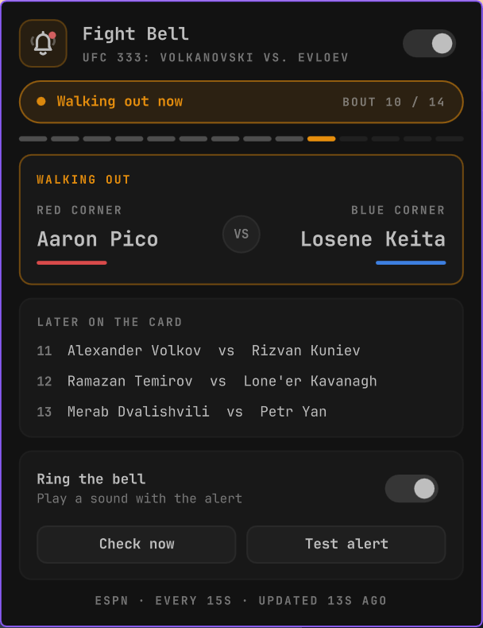

# Fight Bell

UFC walkout alerts for Omarchy. Turn it on, leave your stream, and a desktop alert and a
bell ring the moment the fighters for the next bout walk out. No more checking back
every few minutes between fights.



## Features

- **Rings at the walkout**: ESPN marks the next bout as "pre-fight" as soon as the previous
  one ends, which can be 10+ minutes early. Fight Bell waits for ESPN's **walkout** signal
  (status or play log), so the alert lands a few minutes before the first round.
- **One alert per bout**: if the walkout is missed it rings when the round starts instead,
  never twice. Round breaks, reconnects and shell restarts can't re-trigger it.
- **No spoilers**: winners, methods and results are never read or shown.
- **Bar icon**: a thin-line bell. Slashed when off, faint ring waves while armed, pulsing
  waves with a red dot during walkouts and live fights, an amber dot when ESPN can't be reached.
- **Panel**:
  - status strip (between fights, walking out, live, next card start time) and bout number
  - card progress, one segment per bout
  - tale of the tape for the current or next bout, red and blue corner
  - the next three bouts, with the main event tagged
  - bell sound switch, **Check now** and **Test alert**
- **Light on the network**: checks every 15 s while a card is running or starts within the
  hour, every 10 min the rest of the week, so you can leave it on.
- Settings survive shell restarts.

## Install

```bash
omarchy plugin add https://github.com/zaki2993/zakarch.fight-bell --enable
```

## Remove

```bash
omarchy plugin remove zakarch.fight-bell
rm -rf ~/.local/state/omarchy/zakarch.fight-bell
```

## Usage

- **Click** the bell: open the panel
- **Middle-click** the bell: turn alerts on or off
- Keyboard in the panel: arrows move, `enter` toggles, `esc` closes
- IPC: `omarchy-shell zakarch.fight-bell start|stop|toggle|refresh|test|status`

## Requirements

All present on a stock Omarchy install:

- `curl`: fetches ESPN's public UFC scoreboard
  (`site.api.espn.com`, no account or key)
- `libnotify` (`notify-send`): the desktop alert
- `libpulse` (`paplay`) and `sound-theme-freedesktop`: the bell sound

No sudo, no background processes outside the shell.

## Files

- `Model.js`: feed parsing, fight states, alert and polling rules (pure, tested by `node --test check.js`)
- `Service.qml`: polling, alerts, persistence and IPC
- `BarWidget.qml`, `BellIcon.qml`: bar icon
- `Panel.qml`: popup panel
- State: `~/.local/state/omarchy/zakarch.fight-bell/settings.json`

Note: alerts follow ESPN's live feed, which can trail the broadcast by up to ~30 s.
Fight Bell is not affiliated with the UFC or ESPN.
